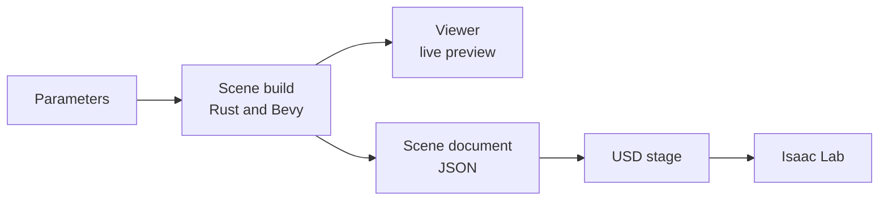
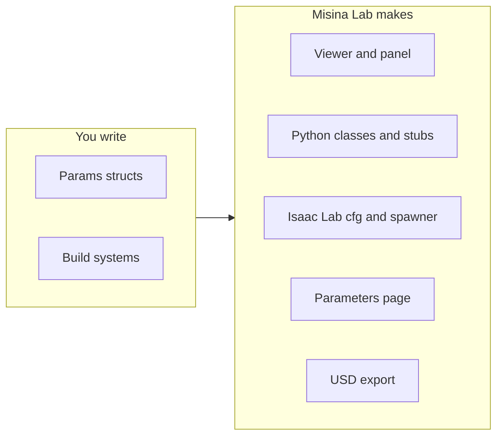

# Misina Lab

[](https://github.com/azazdeaz/misina-lab/actions/workflows/ci.yml)

**A framework for building procedural scene generators for agricultural robotics
simulation.** You write a generator's parameters and build code in Rust, and
Misina Lab makes the rest from them: a live parameter editor, a Python
package, and an Isaac Lab spawner that brings the scene in as USD.

> [!WARNING]
> **Developer preview.** Expect breaking changes.


*A vineyard built on Misina Lab, in Isaac Lab*

It ships with two [reference generators](#reference-generators), a vineyard
and a tomato greenhouse, to try it on and to start from. If you need help, or
would like to work together on a generator of your own,
[get in touch](#support).

> 🌐 Try the vineyard in your browser:
> [azazdeaz.github.io/misina-lab/playground/vinery](https://azazdeaz.github.io/misina-lab/playground/vinery/),
> a bit slower, and it needs WebGPU.
>
> 📚 The docs are at [azazdeaz.github.io/misina-lab](https://azazdeaz.github.io/misina-lab/).

**Contents:** [Features](#features) · [How it works](#how-it-works) ·
[Build a generator](#build-a-generator) ·
[Reference generators](#reference-generators) · [Try it](#try-it) ·
[Roadmap](#roadmap) · [Support](#support) ·
[Development](#development) · [License](#license)

## Features

Every generator built on Misina Lab gets:

- 🎛️ **A live parameter editor.** Every parameter is a slider with a tooltip,
  and the scene rebuilds as you drag.
- 🤖 **Isaac Lab in one paste.** **Copy Isaac Lab cfg** puts the editor's
  settings on the clipboard. Pasted into an env, the scene generates on first
  use, is cached as USD and spawns like any USD file.
- 🐍 **A Python package.** Typed params classes, a headless `write_usd()`, and
  a parameters page with every default and range.
- 🎲 **Reproducible.** The same seed gives the same scene, and nudging one
  part never re-rolls another.
- 🏷️ **Every part addressable.** Every part is a named prim, down to a single
  leaf or fruit, and carries its ground truth, such as ripeness.
- ⚡ **Built to scale.** Level of detail and the number of mesh variants trade
  fidelity for frame rate.
- ✂️ **Bendable, cuttable parts.** Flexible parts bend under Newton's VBD
  solver and can be cut anywhere while the simulation runs.

## How it works



1. A generator declares its parameters as plain Rust structs and builds its
   scene in [Bevy](https://bevy.org) as ordinary meshes and transforms.
2. The viewer draws that scene as it is built, so a slider answers at once.
3. For simulation, the scene leaves Rust as a plain JSON document, and Python
   turns it into a USD stage.
4. In Isaac Lab, the generator's cfg class does this on first use, caches the
   USD, and spawns it as an ordinary USD asset.

## Build a generator

A generator is one Rust crate: its parameters as plain structs, and one build
system per kind of thing in the scene. Everything else is made from those
declarations.



- [The framework's README](crates/misina-lab/README.md) builds the smallest
  generator, a row of boxes, end to end, and indexes the framework's docs.
- [A generator in its own repository](crates/misina-lab/docs/outside-projects.md)
  sets one up outside this one.
- The [reference generators](#reference-generators) are the full-size ones to
  start from.

## Reference generators

Both are built on Misina Lab. Each is a Python package of its own, and a
starting point for a new generator.

- [Vinery Lab](#vinery-lab): vineyards
    - [Quadruped example](examples/isaaclab_demo/README.md)
    - [Straddler example](examples/straddler_demo/README.md)
    - [Pruning example](examples/pruning_demo/README.md)
- [Greenhouse Lab](#greenhouse-lab): tomato greenhouses

### Vinery Lab

Vineyards for developing and testing vineyard robots: trellised rows on
rolling terrain, down to every leaf.

- 🍃 Leaves as detailed meshes, for depth-based perception
- 🌿 Stray shoots that bend as a robot pushes through, and cut anywhere
- ❄️ A dormant mode: bare canes with a bud at every node, every one cuttable
- 🌾 Cover crops in the alleys and weeds under the vines

[README](crates/vinery-lab/README.md) ·
[Parameters](crates/vinery-lab/docs/parameters.md) ·
[Playground](https://azazdeaz.github.io/misina-lab/playground/vinery/) ·
`pip install vinery-lab`

#### Examples

| Example | What it shows |
| --- | --- |
| [Quadruped](examples/isaaclab_demo/README.md) | An ANYmal-C walks every alley, down one and back up the next. |
| [Straddler](examples/straddler_demo/README.md) | A portal robot drives every row with the trellis passing under its frame. `--trim` hedges the stray shoots. |
| [Pruning](examples/pruning_demo/README.md) | A Bumblebee-like arm on a UGV cuts every cane of a dormant row back to two buds. |

Each is a uv project of its own: `cd` into it and `uv run main.py`. They build
the generator from this checkout, so they need
[Rust](https://www.rust-lang.org/tools/install) and hardware that runs
Isaac Sim 6.1.

### Greenhouse Lab

The rows of a high-wire tomato greenhouse, grown to any week of the season.

- 🍅 Every fruit its own prim, with its ripening stage
- 🦾 A `Cut` and a `Bend` frame on every truss, where a gripper takes it
- 📅 The crop's age in weeks, from young plants on their twines to meters of
  lowered stem
- 🛤️ Heating-pipe rails in every path, uneven up to and past the 2° spec

[README](crates/greenhouse-lab/README.md) ·
[Parameters](crates/greenhouse-lab/docs/parameters.md) ·
`pip install greenhouse-lab`

## Try it

**In the browser.** The vineyard's viewer runs at
[azazdeaz.github.io/misina-lab/playground/vinery](https://azazdeaz.github.io/misina-lab/playground/vinery/).

**From Python.**

```bash
pip install vinery-lab        # the vineyard
pip install greenhouse-lab    # the greenhouse
```

Wheels are built for Linux x86_64 and Python 3.12 and later; anywhere else
pip builds from source, which needs
[Rust](https://www.rust-lang.org/tools/install).

**From a checkout**, with Rust installed, either reference generator opens in
the viewer:

```bash
cargo run --release                     # the vineyard
cargo run --release -p greenhouse-lab   # the greenhouse
```

Move a slider and the scene rebuilds what it touches. **Copy Isaac Lab cfg**
puts the settings on the clipboard, ready to paste into an Isaac Lab env.

https://github.com/user-attachments/assets/529d2e5b-2bfa-458f-81d0-02c65c27ba53

## Roadmap

**Upcoming**

- Optionally use PointInstancer to spawn organs without a unique prim path
- Simulate human workers and other safety critical scenarios

**Planned**

- RTK-GNSS data generation
- GeoJSON and TASKDATA.xml export
- Complete example projects demonstrating task executions
- **Share what you need for your project 🚀**

Each reference generator's README has its own roadmap.

## Support

If you need help with Misina Lab, or would like to work together on a
generator for your own crop, layout or equipment, feel free to reach out to
[@azazdeaz](https://github.com/azazdeaz). General questions and suggestions 
are just as welcome.

## Development

- [AGENTS.md](AGENTS.md): the repo map
- [DEVELOPMENT.md](DEVELOPMENT.md): building, the checks, releasing, the docs
  site
- [CHANGELOG.md](CHANGELOG.md): what each release changed

## License

Licensed under either of [Apache License, Version 2.0](LICENSE-APACHE) or
[MIT License](LICENSE-MIT), at your option.
