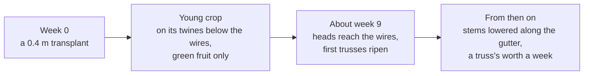

# Greenhouse Lab 🍅

The rows of a Western European high-wire tomato greenhouse, generated for
robotics simulation and authored to USD for Isaac Lab: the floor, the pipe
rails, the gutters with their slabs and blocks, the crop wires, and the
crop on them: stems, leaves, trusses and fruit. The building, its roof,
glass and columns, is left to an HDR or a Gaussian splat. It is one of
[Misina Lab's reference generators](../../README.md#reference-generators).

> [!WARNING]
> **Developer preview.** Expect breaking changes.


*The default greenhouse in Isaac Lab, from [its example](../../examples/greenhouse_demo/README.md)*


*The viewer and its parameter panel, down a path between two rows*

> 🌐 Try the parameter editor in your browser:
> [azazdeaz.github.io/misina-lab/playground/greenhouse](https://azazdeaz.github.io/misina-lab/playground/greenhouse/),
> a bit slower, and it needs WebGPU.

**Contents:** [What a row holds](#what-a-row-holds) ·
[The crop's age](#the-crops-age) · [Running it](#running-it) ·
[Prims](#prims)

The dimensions and the variations are drawn from Dutch research
compartments, supplier sheets and one measured truss study.
A stem keeps its leaves from the head down and is stripped below them, as
growers leave it, so the trusses in the harvest band hang off bare stem.

## What a row holds

| Part | What it is | Knobs |
| --- | --- | --- |
| Floor | white film under the crop and concrete across the row heads, each its own collider | the main path's width |
| Rail | two heating pipes in every path, on a support every meter, each segment a capsule collider | gauge, pipe diameter, height, unevenness up to and past the 2° spec |
| Gutter | a steel channel, hanging or standing, with stone wool slabs and a block at every plant | height, mount, plant spacing |
| Wires | two crop wires over every gutter, for the V the stems are trained in | height, spread |
| Stems | two to a plant, each grown up its twine to a hook on its wire and lowered along the gutter from then on; a leaf at every node and a truss in every third internode, the leaves stripped below the top few with a stub left at each | the crop's age, harvest height, trusses on a stem, leaves kept, extra stems, trusses turned to the path |
| Leaves | a compound leaf: a petiole and a rachis with a terminal leaflet, three or four pairs of laterals and small leaflets between them, each leaflet outlined from its veins; small and upright at the head, drooping further down. Visual only, with no collider | length, droop, mesh detail |
| Trusses | the peduncle bending over into a rachis that zigzags from fruit to fruit, kinking away from each pedicel and hanging nearer vertical toward its tip, and an arched pedicel to every fruit, with a `Cut` and a `Bend` frame; below a height, a rod a solver bends and a robot cuts, carrying its fruit | fruit count and diameter, branched, peduncle length, diameter and angle, missing fruit; the height trusses bend below, on the stems |
| Fruit | every fruit its own prim with a collider round it, a calyx of five or six narrow sepals spreading off its shoulders, and a stage from fruit set to red: fruit grow toward the head, a stem ripens from the bottom up, a truss from its base to its tip, and a fruit from its blossom end | ripe trusses on a stem, the spread in a truss, the ripe colour, height to width, ribbing, jointed pedicels |

Rows run along +X from the row head at x = 0, the main path lies at
negative x, and z = 0 is the top of the floor. Every gutter has a path on
both sides, so every crop wall faces one a robot can drive.

## The crop's age

The crop is grown to an age, `scene.week`, the weeks since planting:



A stem grows about a truss a week, so a crop deep into the season has meters
of bare stem lying along the gutter beside it.

## Running it

From the repository root,

```bash
cargo run --release -p greenhouse-lab
```

opens the viewer and its parameter panel. From Python, after
`pip install greenhouse-lab`:

```python
import greenhouse_lab

params = greenhouse_lab.GreenhouseParams()
params.rail.unevenness = 1.0
params.write_usd("greenhouse.usda")
```

In Isaac Lab, `greenhouse_lab.isaaclab.GreenhouseCfg` spawns the scene as
an asset; [examples/greenhouse_demo](../../examples/greenhouse_demo/README.md)
is the smallest script that does. [docs/parameters.md](docs/parameters.md)
lists every parameter, with its default and range.

## Prims

```text
/Greenhouse
  /Floor/Film  /Floor/Concrete        each its own collider
  /Paths/Path_03/Rail
    /Pipe_L_007/Steel  /Collision     one segment, support to support
    /Support_L_007 …
  /Rows/Row_02
    /Gutter  /Hanger_00 …  /Slab_00 …  /Block_017 …
    /Wire_L  /Wire_R
    /Plant_017
      /Stem_0
        /Tube  /Hook  /Twine
        /Leaf_00 …                    the lowest still on the stem first
        /Truss_00                     the lowest still on the stem
          /Peduncle  /Cut  /Bend
          /Fruit_00/Skin  /Collision  a sphere round the body, a capsule on an elongated one
          /Fruit_01 …
```

`Cut` sits at the peduncle's base and `Bend` where it bends most, each with
+X along the peduncle: where a cut-flush gripper and a clamp-and-cut one
take a truss. Every fruit carries `greenhouse_lab:stage`, its growth stage
or USDA colour class, and `greenhouse_lab:ripeness`, the share of its
surface that has coloured.

A truss whose node is below `StemCfg.flexible_below` is a rod instead, its
peduncle and rachis a `Cable` and a prim per segment that Newton drives:

```text
        /Truss_00
          /Cable                      the curve the solver bends, never drawn
          /Cable_edge_body_0 …        a segment, its tube as /Stem
            /Pedicels  /Fruit_00 …    whatever leaves the rachis on it
            /Bend                     on the segment at the bend's middle
          /Cut
```

The fruit weigh on the rod, and `Cut` sits within a centimetre of its first
joint, so `Shears` cutting there drops the whole truss. A fruit's collider
rides its segment's body too, seated there by the rod tuning, and passes
through its own truss.

Left is +Y: the side on the left looking down a row from its head. A
standing gutter has `Stand_00 …` where a hanging one has hangers.
