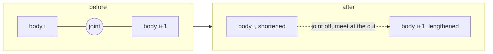

# Cutting

> [!WARNING]
> **Under development.** This page may not reflect the current state of
> the source. We're working on it.

A **rod** is how [Newton](https://newton-physics.github.io/newton/latest/),
the physics engine under Isaac Lab, simulates a flexible **organ**: one
stem or leaf that bends ([mesh-variations.md](mesh-variations.md)). A rod
is a chain of rigid bodies, one per segment of the organ, joined by joints
that bend. Its first body is fixed to the **wood**, the part of the plant
that the organ grows from and that does not move.

A cut parts a rod at any point along it while the simulation runs. The
part past the cut, the **piece**, falls. The part still attached to the
wood, the **stub**, stays where it is.

`Shears`, a class in the framework's Python package, makes the cuts. Build
it once the Newton model exists, and keep it: it records which bodies are
cut free.

```python
from misina_lab.isaaclab import Shears

sim.reset()        # Isaac Lab's first reset builds the Newton model,
shears = Shears()  # so Shears is built after it
while simulation_app.is_running():
    sim.step()
    # The knife's reach: a rectangle in world coordinates, given as one
    # corner and the two edges that leave it. Here it is 10 cm square,
    # upright, 1 m above the origin.
    corner, u, v = (0.0, 0.0, 1.0), (0.1, 0.0, 0.0), (0.0, 0.0, 0.1)
    cuts = shears.cut_through(corner, u, v)
```

| Call | What it does |
| --- | --- |
| `cut_through(corner, u, v)` | cuts each rod body not yet cut free where its centre line passes through the rectangle. The rectangle's points are `corner + a*u + b*v`, with `a` and `b` from 0 to 1. Returns how many cuts it made |
| `crossing(corner, u, v)` | reports where rods cross the rectangle, without cutting: each crossing body as an index into `bodies`, the fraction along it where it crosses, and where on the rectangle. A rod that crosses twice is listed twice. A crossing that falls exactly on a joint, where one body ends and the next begins, is not reported, so `cut_through` makes no cut there |
| `cut(body, at)` | cuts one rod body at `at`, a fraction of its length from 0 at the end nearer the wood to 1 at the other; returns whether anything fell |
| `hold(body, frame)` | holds a rod body at its place in `frame`, and moves it with the frame, for example to carry a piece in a gripper. `frame` is a pose in world coordinates: an array of seven numbers, the position and then the rotation as a quaternion (x, y, z, w). The held body turns kinematic: only code moves it, not forces. Call it before every step. The rest of the rod hangs from the held body. `hold(None, frame)` lets it go |
| `bodies`, `loose`, `capsules()` | every rod body, by its index in the model; which of them are cut free; each one's centre line in world coordinates, as its two ends |

## A rod in Newton

A generator makes an organ flexible by writing it into the scene document
as a `Cable`, a curve. The scene document is the JSON description of the
built scene, which Python turns into USD
([export.md](export.md#flexible-organs)). Newton's rod importer turns each
segment of the curve into one capsule body. A capsule is a cylinder with a
half sphere on each end. The bodies are numbered from the wood outward.
Between each two bodies the importer puts a
[rod joint](https://newton-physics.github.io/newton/latest/concepts/deformable_objects.html),
which has four stiffnesses: stretch, shear, bend and twist. The importer
works them out from the organ's material. `tune_rods`, in
[`rods.py`](../../../python/misina-lab/misina_lab/isaaclab/rods.py),
softens stretch and shear and damps bend and twist
([isaac-lab.md](isaac-lab.md#rods)). The first body has no mass, which
Newton treats as fixed: no force moves it, so it holds the organ to the
wood.

Only Newton's
[VBD solver](https://newton-physics.github.io/newton/latest/solvers/vbd.html),
vertex block descent, steps a rod. A robot needs MJWarp, Newton's GPU
version of MuJoCo. So a scene with rods runs both in one
[coupled solver](https://newton-physics.github.io/newton/latest/concepts/coupling.html).
Each of its two entries steps its own bodies: `rigid` the robot, `rods`
the rods. The robot bodies named in `contact_bodies` are copied to the VBD
side as **proxies**, bodies that follow the robot's and that the rods
collide with. [isaac-lab.md](isaac-lab.md#rods) covers that setup.

Newton allows no new body and no new joint once the model is built. So a
cut only changes values the model already holds:

- the length, mass and collider of two capsules;
- one joint, which is turned off;
- one row of the contact-pair list
  ([below](#letting-the-two-faces-meet));
- the collision groups of the piece's shapes;
- the place of any collider that the cut hides.

The two bodies on either side of a cut are bodies the model already had.

## Where a cut is made

Newton parts a rod only at a joint, by turning the joint off. So a cut
between two joints first resizes the two capsules at the next joint, so
that they meet at the cut. `SPLINTER`, a constant of 1 cm in `cutting.py`,
is the shortest part a cut leaves on either side of it. Where `cut(body,
at)` puts the cut depends on where `at` falls:

| Where the cut is | What happens |
| --- | --- |
| within `SPLINTER` of a joint | made at that joint, and no capsule's length changes |
| within `SPLINTER` of the wood end of a rod's first body | made at the joint at the other end of that body, since no joint ties the first body to the wood |
| on a rod's last body, or on the last body of a stub an earlier cut left | the whole body falls: there is no next body to take the part past the cut. Within `SPLINTER` of its free end, nothing falls. Nothing falls either when that body is the rod's first |
| on a body already cut free | nothing: a piece is not cut again |
| anywhere else | the two capsules at the next joint are resized to meet at the cut ([below](#cutting-between-two-joints)), and that joint is turned off |

A rod that passes through the rectangle twice is cut once by `cut_through`,
at the crossing nearer the wood. The other crossing is on the piece that
falls.

## Cutting between two joints

A cut between two joints falls on one capsule, body i. Body i is shortened
to end at the cut, and the next body, i+1, is lengthened to start there.
The joint between them is then turned off. The part of body i past the cut
is now part of body i+1, and falls with the piece.

The mass of the part past the cut moves from body i to body i+1 with it,
so the rod's total mass stays the same. Each body's centre of mass moves
to the middle of its new capsule, and its inertia is recomputed as that of
a solid cylinder of the new length. The rod's first body has no mass, and
keeps none.



The part moved to body i+1 is placed straight along body i+1's axis. If
the rod is bent at that joint, the part is a little out of place: by about
1 cm for a part a whole segment long, at a bend of 10 degrees.

What is drawn follows every cut:

- A rod drawn as tubes has one per segment, a prim named `Stem` under the
  segment's prim. A prim is one object in the USD scene. The tube is
  scaled along its axis to the capsule's new length.
- A rod drawn by a skin, a mesh that the rod's bodies bend
  ([isaac-lab.md](isaac-lab.md#skins)), has its skin split at the cut.
- Anything else under body i's segment prim past the cut, such as a leaf,
  is hidden. A prim stays on the body it was placed under, and body i no
  longer reaches past the cut. A collider under the hidden prim, which
  `rods.carry_riders` attached to body i, is moved 100 m along the body's
  axis (`PARKED`), where it touches nothing.

## How Newton finds contacts

Newton finds contacts in two steps. The **broad phase** picks the pairs of
shapes close enough to be worth testing, and the narrow phase tests them.
Two settings on the shapes decide which pairs may ever collide:

- A **collision group** is one integer per shape:
  - a positive group collides with itself and with every negative group;
  - a negative group collides with every group except itself;
  - group 0 collides with nothing.
- A **filter pair** is a pair of shapes that never collide. By default
  each joint adds one, for the shapes of the two bodies it joins.

When the model is finalized, the last step of building it, Newton checks
every pair of shapes. It keeps each pair that the groups allow and no
filter pair forbids. It stores them in `Model.shape_contact_pairs`, the
**contact-pair list**: an array with one row per pair.
`make_physics_cfg_newton`, which builds the physics config of a scene with
rods ([isaac-lab.md](isaac-lab.md#rods)), takes a `broad_phase` argument:

| `broad_phase` | What it tests every step |
| --- | --- |
| `"explicit"`, the default | the contact-pair list and nothing else. A pair not on the list never collides, since the groups and filter pairs were read once, at finalize |
| `"nxn"` or `"sap"` | every pair of shapes whose bounding boxes overlap, checking the groups and filter pairs every step. `"nxn"` tries every pair; `"sap"`, sweep and prune, sorts the boxes along an axis to find the ones that overlap. The framework gives both one buffer for the scene, with room for `rods.PAIRS_PER_SHAPE`, 16, candidate pairs per shape; past that, Newton warns of a buffer overflow each step |

## Letting the two faces meet

Once the joint is off, the stub's last body and the piece's first body are
free of each other. Their capsule ends at the cut are the two **faces** of
the cut. But at finalize, the joint's filter pair kept these two shapes off
the contact-pair list, and turning the joint off does not add them. Under
the explicit broad phase the two faces would never collide. The piece
would fall through the stub's last segment until it met the segment before
it, then slide off.

So the framework adds a spare row to the list for every rod joint. It does
this after the model is finalized and before any solver holds the list,
since a solver that already held it would keep reading the old, shorter
list. `tune_rods` registers a callback on Isaac Lab's `PHYSICS_READY`
event, which fires in that window. The callback checks
`rods.reads_contact_pairs`, which is true when the chosen broad phase is
the explicit one. If it is, the callback calls `rods.reserve_contact_slots`.
That replaces the list with a longer one: every row it had, then one spare
row per rod joint. A model built by hand, without `tune_rods`, calls
`reserve_contact_slots` itself.

Each spare row is **parked** until a cut uses it: it holds a pair of two
static shapes, shapes on no body. Every broad phase drops a pair of two
static shapes before testing it, so a parked row never makes a contact and
costs almost nothing. So a scene that is cut under the explicit broad
phase must contain two static shapes to park the rows on: two posts are
enough. They must have collision turned on, because each solver entry
keeps only the rows whose shapes collide, and be neither a ground plane
nor a height field (a terrain grid). Without two such shapes,
`reserve_contact_slots` raises a `ValueError`.

When a cut turns a rod joint off, `Shears` writes the joint's two capsules
into that joint's row. From the next step the broad phase tests them like
any other pair.

A cut also shortens the colliders at the two faces, so that they touch
without pushing apart. A capsule's round end reaches one radius past the
end of its segment. So two capsules that meet at a cut would overlap there
by a whole rod thickness, and their first contact would push the two parts
apart. A cut therefore shortens each collider by one radius at its cut
face. Its round end then reaches exactly to the cut, and the two touch
there. What is drawn keeps its full length. A cut at a joint shortens the
same two faces. A collider too short to lose that much becomes a sphere.

Under `"nxn"` or `"sap"` nothing reads the rows, so `tune_rods` reserves
none, and the scene needs no static shapes to park them on. `Shears` on a
model with no rows opens none. These broad phases check the joint's filter
pair every step, so the two faces of a cut never collide: the piece falls
through the stub's last segment onto the segment before it. A cut gives
the piece new collision groups instead
([What a piece does afterwards](#what-a-piece-does-afterwards)).

## What a piece does afterwards

A **plant** is everything under one prim whose name is the cfg class's
`PLANT` and an index: `Plant_007` when `PLANT` is `"Plant"`. The cfg class
is the Isaac Lab config class that generates the scene on first use,
caches it as USD and spawns it ([isaac-lab.md](isaac-lab.md)). For
collisions, a plant's wood is the static colliders under its prim.

`tune_rods` gives the shapes these collision groups:

- each plant's rods and wood: one positive group per plant, counting up
  from `PLANT_GROUPS`, 2. A rod under no plant's prim counts as a plant of
  its own;
- the ground and every other static shape: `SCENE_GROUP`, -1;
- every other body, such as a robot's: a negative group of its own;
- a shape in group 0 stays there.

Under the explicit broad phase the groups were read once, at finalize. So
a falling piece collides with its own plant's stub, rods and wood, the
ground, the other static shapes and the robot. It passes through every
other plant, since each plant has its own positive group. The robot here
is only the proxies, the bodies named in `contact_bodies`. A rod segment
that starts inside a wood collider of its own plant never collides with
that collider, even after it is cut free
(`rods.let_rods_out_of_their_wood`).

Under `"nxn"` or `"sap"` the groups are read every step, so a cut can
change them. `Shears` gives each body of the piece a negative group of its
own, the kind `tune_rods` gives every body that is not a rod. A shape in
group 0 stays there. From the next step the piece collides with every
plant's rods and wood, every other piece, the ground, the static shapes
and the robot. The one exception is the stub's face at the cut: the
joint's filter pair still forbids that contact, so the two faces pass
through each other. Under the explicit broad phase the same change has no
effect.

| | `"explicit"` | `"nxn"` or `"sap"` |
| --- | --- | --- |
| a piece collides with | its own plant, the static scene and the robot | every plant, every other piece, the static scene and the robot |
| the stub's face at the cut | collides with the piece | passes through it |
| what it costs | a pair list sized by the groups | a pair buffer of 16 candidate pairs per shape |

VBD does not model rolling friction. So a straight piece on a slope keeps
rolling downhill, even off the edge of the terrain, unless something stops
it.

## Where it lives

- [`misina_lab/isaaclab/cutting.py`](../../../python/misina-lab/misina_lab/isaaclab/cutting.py): `Shears`, `SPLINTER`, `PARKED`; `Shears.cut`, `cut_through`, `crossing` and `hold`; `_split` for cutting between joints, `_release` for the row and the shortened colliders, `_free` for the new groups
- [`misina_lab/isaaclab/rods.py`](../../../python/misina-lab/misina_lab/isaaclab/rods.py): `ContactSlots`, `reserve_contact_slots`, `reads_contact_pairs`, `PLANT_GROUPS`, `SCENE_GROUP`, and `tune_rods`, which registers the reservation
- [`tests/test_isaaclab_cutting.py`](../../../tests/test_isaaclab_cutting.py): a bare Newton rod, no Kit and no coupler, cut and stepped
