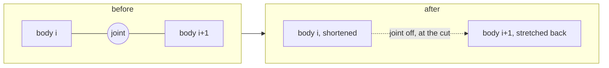

# Cutting

A cut parts a rod anywhere along it while the simulation runs, and lets the
part past the cut fall. A rod is how Newton steps a flexible organ, a chain
of capsule bodies tied by rod joints, and Newton allows no new body and no
new joint once the model is built, so a cut is made from what the model
already holds: the joint nearest the cut is moved onto it, the two capsules
either side are resized to meet there, and the joint is turned off. One more
thing is needed for the two faces of the cut to touch rather than pass
through each other, and that is the part of this page that is not obvious.

```python
from misina_lab.isaaclab import Shears

shears = Shears()  # after the first reset: the model exists from then on
while simulation_app.is_running():
    sim.step()
    # A knife's reach: a rectangle in world coordinates, corner and two edges.
    cuts = shears.cut_through(corner, across, along)
```

`Shears` is built once and kept, since it tracks which rods are cut.
`cut_through` cuts every rod still whole whose axis passes through the
rectangle; `cut(body, at)` cuts one body at a fraction of its length;
`crossing` reports what `cut_through` would cut, without cutting.

## A rod in Newton

A flexible organ is authored as a `Cable` ([export.md](export.md#colliders))
and imported by Newton's rod importer as one capsule rigid body per segment,
numbered from the wood out, with a [rod joint](https://newton-physics.github.io/newton/latest/concepts/deformable_objects.html)
between each two: four stiffnesses, stretch, shear, bend and twist, which
[`rods.py`](../../../python/misina-lab/misina_lab/isaaclab/rods.py) retunes
in `tune_rods`. The first body is kinematic, which is what bolts the organ
to the wood it grew from. Only the
[VBD solver](https://newton-physics.github.io/newton/latest/solvers/vbd.html)
steps a rod, so a scene with a robot runs VBD beside MuJoCo as entries of a
[coupled solver](https://newton-physics.github.io/newton/latest/concepts/coupling.html),
with the robot's bodies handed to the rod side as proxies;
[isaac-lab.md](isaac-lab.md#rods) covers that setup.

Two facts about the collision side decide how a cut has to be made:

- Which two shapes may ever touch is settled when the model is finalized.
  Each shape carries a [collision group](https://newton-physics.github.io/newton/latest/concepts/collisions.html#collision-groups),
  and each joint, by default, adds its two bodies' shapes to the
  [filter pairs](https://newton-physics.github.io/newton/latest/concepts/collisions.html#shape-collision-filter-pairs).
  Finalize walks every pair of shapes, keeps the ones the groups allow and
  the filter does not forbid, and writes them to `Model.shape_contact_pairs`.
- The default [broad phase](https://newton-physics.github.io/newton/latest/concepts/collisions.html#broad-phase-and-shape-compatibility),
  the explicit one, tests exactly that list every step, and nothing else:
  not the groups, not the filter pairs. A pair that is not in the list never
  meets, whatever happens to the joint that kept it out.

## Where a cut lands

`cut(body, at)` takes a fraction of the body's capsule, 0 at the end nearer
the wood. Three cases, all ending with one joint turned off:

| the cut | what happens |
| --- | --- |
| within `SPLINTER` of a joint, a centimetre | made at that joint: a body that short would have no mass to divide by |
| on a rod's last body, or on the stub an earlier cut left | the whole body goes, since nothing past it could carry the offcut; within `SPLINTER` of the free end, nothing goes |
| anywhere else | the joint past the body is moved to the cut first, then turned off |

`cut_through` cuts a rod through the rectangle twice at the crossing nearer
the wood: the other is on the piece that falls.

## A cut only writes values

Newton sizes every array, bodies, shapes, joints, the contact-pair list,
when the model is finalized, and the CUDA graph a step replays holds
pointers into them. A value written into one of those arrays in place is
seen by the next replay. A new body, a new joint, or anything that
reallocates an array is not, and would need the solvers rebuilt and the
graph recorded again. So everything a cut does is a write into an array
that already exists, and the two bodies either side of the cut are two the
model already had.

## Moving the joint to the cut

A cut between joints lands on one capsule. That capsule is shortened to end
at the cut, the next one down the chain is stretched back to start there,
and the joint between them, which sat where they used to meet, is turned
off. Mass moves with the length, so the rod weighs what it did; the inertia
of each is recomputed as a solid cylinder of its new length.



The rendered organ follows. The tube drawn along a segment is scaled along
its axis to the capsule's new span, and anything hanging off the shortened
segment past the cut, a leaf, is hidden, since a prim cannot move to the
piece that carries on without it. The piece of body i past the cut now
belongs to body i+1, along body i+1's own axis: on a rod bent at the joint
the piece lands a little out of line, about a centimetre for a full-length
piece at ten degrees.

## Letting the two faces meet

Turning the joint off frees the piece, but the two bodies it tied, now the
stub's top and the piece's bottom, were never in the contact-pair list: the
joint's filter kept them out, and the list is fixed. Left there, the piece
falls through the stub's top segment until its round end meets the next
segment down, then tips off it.

The list cannot grow once something reads it, but there is a moment when
nothing does: the model is finalized, and no collision pipeline and no
solver entry has taken the list yet. Isaac Lab fires `PHYSICS_READY` in
that window, and `rods.ContactSlots`, registered there by `tune_rods`,
replaces the list with a longer one: every row it had, then one spare row
per rod joint. The spare rows are *parked* on a pair of two static shapes a
metre clear of each other, the two furthest apart in the scene. The broad
phase tests every row it is given, static or not, and drops this one on
their bounding boxes every step, so a parked row costs one box test.

When a cut turns a rod joint off, `Shears` writes the joint's own two
shapes into the joint's row, and from the next step the broad phase tests
them like any other pair. The filter pairs still name them, but nothing
reads the filter pairs after finalize.

One more write goes with it. A capsule's round end reaches a radius past
the end of its span, so two capsules that meet at a cut overlap there by a
whole rod thickness, and the first contact between them would shove the
halves apart. So each is pulled back one radius at its cut face: the
collider ends a radius short of the span, the round end reaches exactly to
the cut, and the two touch there. The drawn tube keeps the full span. A
cut at a joint pulls back the same two faces; a splinter's collider can
shrink to a sphere and no further.

## Under the coupled solver

Each entry of the coupled solver steps its own copy of the model's arrays.
Its body and joint arrays are refreshed from the model when `Shears`
notifies a model change, which it does for the masses and for the joint
turned off. Its shape arrays, and its contact-pair list, are written
directly, in every copy, because the shape refresh clones the contact-pair
list anew and the recorded graph would go on reading the old one.

An entry's copy of the list is not the model's: the entry clones it and
compacts it to the pairs whose shapes it can see, keeping their order. The
spare rows name static shapes, which every entry sees, so they survive the
compaction and are the last rows of every copy, and `Shears` finds a
joint's row by counting from the end. It writes a live pair only into the
copies that already pair a rod with something, which is the model's own
list and the rod entry's; the robot's entry keeps its rows parked.

## What a piece does afterwards

A piece that falls meets what its group lets it meet
([`rods.py`](../../../python/misina-lab/misina_lab/isaaclab/rods.py),
`PLANT_GROUPS`): its own plant's stub, rods and wood, the ground, the
trellis and the robot, and passes through every other plant. VBD has no
rolling friction, so a straight piece on a slope can roll on downhill, off
the edge of the terrain if nothing stops it.

## Where it lives

- [`misina_lab/isaaclab/cutting.py`](../../../python/misina-lab/misina_lab/isaaclab/cutting.py): `Shears`, `SPLINTER`; `Shears.cut`, `cut_through` and `crossing`; `_split` for moving the joint, `_release` for the pair and the pull-back
- [`misina_lab/isaaclab/rods.py`](../../../python/misina-lab/misina_lab/isaaclab/rods.py): `ContactSlots`, `reserve_contact_slots`, `PARKING_CLEARANCE`, and `tune_rods`, which registers the reservation
- [`tests/test_isaaclab_cutting.py`](../../../tests/test_isaaclab_cutting.py): a bare Newton rod, no Kit and no coupler, cut and stepped
