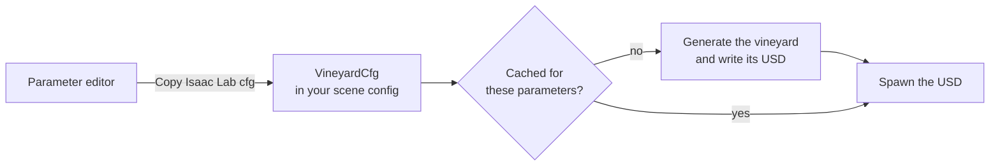

# Vinery Lab 🍇

Open-source parametric vineyard generator for developing and testing vineyard
robots, and one of
[Misina Lab's reference generators](../../README.md#reference-generators).

> [!WARNING]
> **Developer preview.** Expect breaking changes.


*Configured scene in Isaac Lab*


*Standalone parameter editor and visualizer app*

> 🌐 Try the parameter editor in your browser:
> [azazdeaz.github.io/misina-lab/playground/vinery](https://azazdeaz.github.io/misina-lab/playground/vinery/),
> a bit slower, and it needs WebGPU.

**Contents:** [Features](#features) · [Install](#install) ·
[Parameter editor](#parameter-editor) · [Isaac Lab](#isaac-lab) ·
[Examples](#examples) · [Roadmap](#roadmap)

## Features

- 🎛️ Parameter configurator with live preview
- 🎲 Fully reproducible scene generation
- 🍃 Leaves are modelled as detailed meshes to enable depth perception based
  workflows
- ⚡ Performance tuning: LoD and mesh variance are configurable to support
  low-end hardware and large vineyards
- 🏷️ Every plant, shoot and leaf is an addressable prim
- 🌿 Flexible stray shoots that the robot can push aside, and cut anywhere
  along their length
- ❄️ A dormant mode: bare brown canes with a bud at every node, every one of
  them cuttable
- 🌾 Cover crops and weeds

[docs/parameters.md](docs/parameters.md) lists every parameter, with its
default and range.

## Install

```bash
pip install vinery-lab
```

Wheels are built for Linux x86_64 and Python 3.12 and later; anywhere else
pip builds it from source, which needs
[Rust](https://www.rust-lang.org/tools/install). The [examples](#examples)
install it from this checkout instead.

## Parameter editor

From the repository root, with [Rust](https://www.rust-lang.org/tools/install)
installed:

```bash
cargo run --release
```

This brings up the viewer: every parameter is a slider, and the vineyard
rebuilds as you drag. [Misina Lab's front page](../../README.md#try-it) has a
video of it.

## Isaac Lab

`VineyardCfg` is a standard Isaac Lab `FileCfg` config class. The options are
many, so set them in the parameter editor and copy them out of it:



1. Start the parameter editor with `cargo run --release`, or open the
   playground.
2. Edit the scene parameters in the panel.
3. Press **Copy Isaac Lab cfg** to put the current settings on the clipboard
   as a `VineyardCfg(...)` construction, with only the fields you moved.
4. Paste it into your Isaac Lab environment's scene config:

```python
from vinery_lab.isaaclab import VineyardCfg, ParcelCfg, SceneCfg, VineCfg

VINEYARD_CFG = VineyardCfg(
    scene=SceneCfg(seed=42),
    parcel=ParcelCfg(row_spacing=2.8, vine_spacing=1.05),
    vine=VineCfg(arms=1),
)

# in the env's scene config
vineyard = AssetBaseCfg(prim_path="/World/Vineyard", spawn=VINEYARD_CFG)
```

Declare it in a scene: under Newton, the physics holds only the assets a scene
declares, so a vineyard spawned straight onto the stage is one nothing collides
with. A plain script builds an `InteractiveScene` around it, as `design_scene`
in the [quadruped example](../../examples/isaaclab_demo/main.py) does.

## Examples

Each example is a uv project of its own that builds the generator from this
checkout, so it needs [Rust](https://www.rust-lang.org/tools/install) and
hardware that runs Isaac Sim 6.2.

### Quadruped

Navigate the rows with a quadruped. See its
[README](../../examples/isaaclab_demo/README.md) for more detail.

```bash
cd examples/isaaclab_demo/
uv run main.py
```

The same demo on the PhysX backend (the stray shoots spawn static there):

```bash
uv run main.py --physics physx
```

The same demo on MJWarp alone, the fastest of the backends (the stray shoots
spawn static there too):

```bash
uv run main.py --physics newton_mjwarp
```

### Straddler

Drive a straddling robot down every row. See its
[README](../../examples/straddler_demo/README.md) for more detail.

```bash
cd examples/straddler_demo/
uv run main.py
```

The same robot with a hedger hung under it, trimming the stray shoots back to
the canopy:

```bash
uv run main.py --trim
```

### Pruning

Prune a dormant vineyard with a UGV-mounted arm, Bumblebee style: every cane
cut back to two buds, planned from the scene's own bud positions. See its
[README](../../examples/pruning_demo/README.md) for more detail.

```bash
cd examples/pruning_demo/
uv run main.py
```

## Roadmap

**Upcoming**

- More detailed cover crop and weed definitions

**Planned**

- Reconstruct real vineyard parcels from EU vineyard-register data, public
  orthophotos, and regional DTMs
- Support multiple vine-training systems

[Misina Lab's roadmap](../../README.md#roadmap) has what every generator gets
next.
