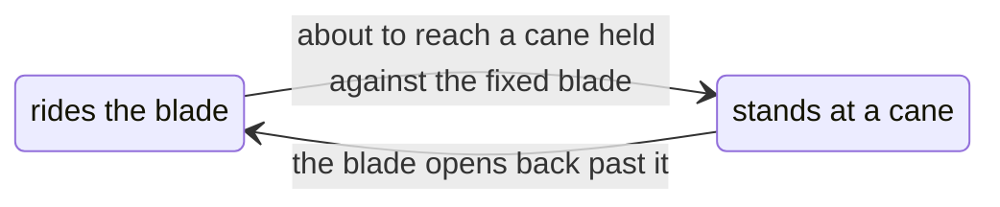

# Dormant pruning demo

A Bumblebee-like robot pruning a row of a
[generated winter vineyard](../../crates/vinery-lab/README.md): a
skid-steer UGV drives the alley, stops at each vine, and an arm on a linear
slide cuts every cane back to two buds with a bypass shear. The cuts are
planned from the scene's own ground truth -- which cane, where each bud is --
rather than from a sensor. The trellis wires are hidden: they have no
collider yet, so the canes and the shear would pass through them.

**Contents:** [Requirements](#requirements) ·
[Running the demo](#running-the-demo) · [Teleoperation](#teleoperation) ·
[Seeing the colliders](#seeing-the-colliders) ·
[Recording the video](#recording-the-video) ·
[What it shows](#what-it-shows) · [How the shear cuts](#how-the-shear-cuts) ·
[The robot](#the-robot) · [Layout](#layout)

## Requirements
 - [uv](https://docs.astral.sh/uv/getting-started/installation/) installed
 - [Isaac Sim 6.2](https://docs.isaacsim.omniverse.nvidia.com/6.2.0/installation/requirements.html) compatible hardware
 - [Rust](https://www.rust-lang.org/tools/install) installed (this demo builds the scene generator from source)

## Running the demo

```bash
uv run main.py
```

The first run downloads the Warthog, generates the vineyard and converts the
robot, and caches all three; later runs start straight up. `--help` lists the launcher's options --
`--row` picks the row pruned, `--physics` the backend and `--viz` the viewer.

Only the default backend, Newton coupled with VBD, bends a cane and so can cut
one. Under any other the canes spawn static and the robot drives the row with
nothing to do.


https://github.com/user-attachments/assets/bb68ad59-d223-4aa3-9e87-be2e6df9ffd0


## Teleoperation

```bash
uv run main.py --teleop
```

The planner stands down and the keyboard has the robot, with the Kit window
focused: the left hand drives, the right hand cuts. The viewport lists the keys
in its bottom right corner.

| key | what it does |
| --- | --- |
| `W` / `S` | drive forward / back |
| `A` / `D` | turn left / right |
| `↑` / `↓` | jog the mouth forward / back along the robot |
| `←` / `→` | jog it toward the row / away from it |
| `Page Up` / `Page Down` | jog it up / down |
| `Enter` | close the shear, cutting every cane the blade closes on, and open it again; the robot holds still while it shuts |

The mouth is a gantry head rather than a wrist: it stays squared up to the
row -- blades out over the rail, pivot upright, so an upright cane lies across
it -- and its position is held in the robot's own frame, so it rides along
when the base drives. It starts out over the rail at spur height, a stand-off
short of the row, and a jog the arm cannot reach is refused.

## Seeing the colliders

```bash
uv run main.py --colliders
```

draws every collider the physics steps, translucent over the scene: blue
for the ground and the vines' wood, green for the canes, magenta for the
robot. Kit draws a PhysX scene's colliders itself, but this one runs on
Newton, which Kit knows nothing about, so the drawing is the framework's
`ColliderView`. It follows what changes while the demo runs: a cut cane's
two segments, one shortened and one stretched, and the shear's slices,
which stand at a cane while the drawn blade closes on through it.

## Recording the video

```bash
./record.sh
```

films a vine of the default scene pruned, in Isaac Sim's RTX renderer and
headless, and writes `target/video/pruning.mp4` at the repo root, captioned
and small enough to upload, and a contact sheet beside it. Its storyboard --
the cases filmed, one per cane, the camera, the pacing -- is the top of
`video.py`; [the skill](../../.claude/skills/pruning-video/SKILL.md) covers
re-recording it and changing what it shows.

## What it shows

The layout is [Bumblebee's](https://arxiv.org/abs/2112.00291) (Silwal et al.,
2021): a Clearpath Warthog in the alley with an aluminium frame on its back,
an arm on a 1.35 m slide along the frame -- a UR10 here, where the paper has a
UR5 -- and a bypass shear in its hand. So is the pipeline, minus the cameras:

1. **The rule.** Keep two buds on every cane and cut midway between the second
   and the third. The scene is generated dormant, so every cane is a rod a
   solver bends, with a `Bud_NN` prim at every node; the planner reads the buds
   off the stage and their live positions off the rod bodies carrying them.
2. **The approach.** Each cut is a pose for the shear's mouth, squared up to
   the cane: the pivot along it, the blades along the approach, aimed afresh
   at the buds when the cut's turn comes. The arm plans to a point 15 cm out,
   where the cut is aimed once more -- the swing out brushes through the
   canes, the one to cut among them -- then closes in on a straight line to
   it and settles there. The shear's head and blades collide with the canes,
   so a cane the mouth comes in on is funnelled between the edges or pushed
   aside, bending as it goes.
3. **The order.** The cuts on a vine are taken nearest neighbour first. A
   cut whose bud to take is gone by its turn -- caught by the blade on a
   neighbouring cane, or by a falling piece -- is left out. Once the last
   is made the arm folds home, at the same top speed it swings at, and the
   robot drives on.
4. **The cut.** Once the arm has settled, the shear closes, and the moving
   blade carries the cane across the mouth onto the fixed one and cuts it
   there, as [the next section](#how-the-shear-cuts) tells. Every cane the
   blade closes on is cut, each as the blade reaches it. A cane the blade
   never reaches, pushed out of the mouth on the way in or never in it, is a
   miss.
5. **The fall.** The piece meets its own vine -- the stub, the other canes,
   the cordon -- the ground and the robot, and passes through every other
   vine: it catches on the stub for a moment, tips, and slides down beside
   it. One that falls into the open mouth or onto the blades would ride
   along to the next cut, where the blade does not cut it, being loose; so
   the arm, backed out, tips the blades down until it slides off.

The score is printed after every vine, and against the paper's at the end:
cuts reachable, cuts made, cuts made at the right place -- the kept bud still
on the vine and the next one gone -- and seconds per vine. Bumblebee reports
87% of cuts made at the right place, 213 s per vine and 68% of canes reachable
from one side. On the default scene the demo reaches all 72 cuts of its row
and makes every one at the right place, at 20 s of simulated time per vine.
Because the simulation knows the true plant, the score keeps "chose the right
cut" apart from "made the cut", which a field trial cannot.

## How the shear cuts

The shear's blades are a bypass pruner's. The moving one is the cutting
blade, its edge convex and ground on its outer face; it closes past the
fixed one, the hook, whose concave edge is the crook a cane is held in and
whose claw reaches past the cutting blade's tip. The two edges are one
curve when shut, so the open mouth spans the same angle at every distance
out from the pivot. A cane coming in outside the hook's tip slides off its
back, so the mouth's point a cane is brought to keeps clear of the tip: the
centre of the widest circle between the straight lines from the pivot to
the two tips. Each blade is drawn as a mesh `shear.py` writes beside the
URDF, and collides as convex pieces along it, the moving blade's being the
slices below.

A real bypass shear closes its moving blade past a fixed one, and the wood
between them gives. A simulated cane does not give: a blade closing on it
would squeeze it against the fixed blade until the solver shoved it out
sideways. So the cut is made by rule, a control tick at a time, and the
moving blade's collider stops at the cane while the drawn blade closes on
through it, the way a real edge goes into the wood.

The collider does not stop whole. The moving blade collides as eight slices
end to end along it, a centimetre each, and each slice stops on its own:

```text
pivot                                              tip
  [ 0 ][ 1 ][ 2 ][ 3 ][ 4 ][ 5 ][ 6 ][ 7 ]   one convex piece each
                              ( cane )       5 and 6 stand at it,
                                             the rest close with the blade
```

Every tick while the shear closes, `shear.Stroke`:

1. **Carries.** A slice rides the blade, and pushes a cane in the mouth
   across, onto the fixed blade.
2. **Stands.** A slice about to reach a cane that lies against the fixed
   blade stops a millimetre off its bark, at the angle where the edge
   touches it, and stays there. Only the slices along which the edge meets
   the cane stop, those within a cane's radius of it, so the tip and the
   root close on with the blade and collide where it is drawn.
3. **Cuts.** The drawn blade goes on closing into the cane, and on the tick
   its edge passes the cane's axis the cane is cut there, with
   `Shears.cut`. Each cane is cut on its own tick: two canes in the mouth
   stand their own slices and are cut in turn, in the order the edge
   reaches them.
4. **Meets.** As the blades meet, every cane still between them is cut
   too: one the blade carried but never pressed onto the fixed blade, and
   one the open blade was in already when the stroke began, gone into
   rather than closed on.

A cane the blade is still carrying across is not cut before the blades
meet, even when it has sunk into the blade past its axis: the solver lets a
pushed cane sink in a little, and a cut there would be made in mid-air.
Nothing is crushed between the blades and nothing the cane leans on is
pulled from under it. Opening, a standing slice rides the blade again once
that has opened back past it, so every stroke starts with the blade whole:



`Shear.slices` sets how many slices there are. `--colliders` shows them
at work: the magenta slices at the cane stand still while the steel blade
closes on through it.

## The robot

`Bumblebee` in `bumblebee.py` is a dataclass of dimensions, and the URDF is
generated from it. The chassis is the Warthog as Clearpath's own
[description](https://github.com/warthog-cpr/warthog/tree/55555b6db5fc7aa7b710b5652f7cb5bf0589ec6a/warthog_description)
draws and weighs it; the first run downloads it from the
[misina-lab-sim-assets](https://huggingface.co/datasets/azazdeaz/misina-lab-sim-assets)
dataset on Hugging Face, and later runs find it in the local cache. Its links
are copied into the generated URDF with its rockers fixed: the real machine has
a differential bar between them that holds the chassis level, which the URDF
leaves out. The frame on its back and the slide along it are the paper's, drawn
from primitives, the rail out over the Warthog's left fenders, toward the row.
The arm is the stock UR10 that Isaac Sim's URDF importer ships, Universal
Robots' meshes and all: its links are copied into the generated URDF as they
are, standing on the carriage, so the arm is part of the robot's one
articulation and rides the slide. Isaac Lab's `UR10_CFG` would spawn it as an
articulation of its own, fixed to the world. `Bumblebee.chain` reads the same
joints out of that URDF for `kinematics.py`, which poses the arm with damped
least squares; the solver and the simulation come from one description.

## Layout

| file | what it owns |
| --- | --- |
| `main.py` | the vineyard, the sky, the robot, the simulation loop |
| `bumblebee.py` | the robot: the Warthog, its dimensions, the URDF built from them, the actuators |
| `shear.py` | the bypass shear: its blades' geometry, their meshes and colliders, and `Stroke`, the blade closing through the canes; the greenhouse demo's module, kept the same |
| `kinematics.py` | forward and inverse kinematics of the arm on its slide |
| `pruner.py` | the ground truth off the stage, the rule, the cut sequence, the score |
| `driver.py` | driving the skid steer from stop to stop |
| `teleop.py` | the keyboard driving the base, jogging the mouth and working the shear |
| `video.py`, `record.sh` | the video: a vine pruned case by case, filmed headless, and its encoding |

`DEVELOPMENT.md` in `../isaaclab_demo` covers the pinned Isaac Lab release,
which this example shares.
